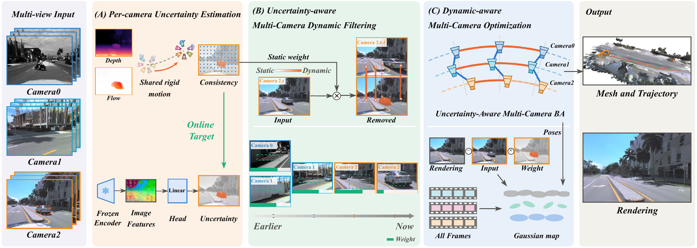

<h2 align="center">DRMC-SLAM: Dynamic-Robust Multi-Camera SLAM via Multi-View Geometric Consistency</h2>

<p align="center">
Qi Shao<sup>1,2,*</sup>, Zhihao Cao<sup>3,*</sup>, Taoyu Wu<sup>4</sup>, Shuhao Zhai<sup>5</sup>, Anh Nguyen<sup>2</sup>, Haoran Luo<sup>6</sup>, Hong Liang<sup>1</sup>, Baoru Huang<sup>2,7</sup>
<br>
<sup>1</sup>Harbin Engineering University &nbsp; <sup>2</sup>University of Liverpool &nbsp; <sup>3</sup>ETH Zürich &nbsp; <sup>4</sup>Xi'an Jiaotong-Liverpool University
<br>
<sup>5</sup>University of Ottawa &nbsp; <sup>6</sup>The Hong Kong Polytechnic University &nbsp; <sup>7</sup>Imperial College London
<br>
<sup>*</sup>Equal contribution
</p>

<p align="center">
  
</p>

## Abstract

Multi-camera SLAM jointly estimates ego-motion and reconstructs the surrounding scene from calibrated surround-view cameras, making it an important perception capability for autonomous driving and embodied systems. However, existing multi-camera SLAM largely assumes a static world, while single-camera dynamic SLAM identifies moving content relative to the motion estimated from its own view, which becomes unreliable when co-moving or nearby vehicles dominate the image. Moreover, removing dynamic objects leaves occluded background unobserved in individual views, while residual dynamic observations from any camera can contaminate the shared map and produce persistent ghosting artifacts. To address these limitations, we introduce DRMC-SLAM, a dynamic-robust multi-camera Gaussian SLAM framework that uses shared ego-motion to identify reliable static observations across cameras. Consistency with this shared motion is used to estimate dense per-camera uncertainty, which continuously weights both tracking and Gaussian mapping to suppress unreliable dynamic content. DRMC-SLAM further recovers occluded static regions from complementary views across cameras and time, and jointly refines all camera poses and the Gaussian map under the same uncertainty weights. Extensive experiments on real-world dynamic datasets demonstrate that DRMC-SLAM achieves state-of-the-art performance in both tracking and rendering.

## Code

Code will be released soon.

## Data

The experiments use ten logs from the validation split of the [Argoverse 2 Sensor Dataset](https://www.argoverse.org/av2.html), selected by the image area covered by moving objects. Each sequence has 160 frames at 10 Hz from eight cameras: the front stereo pair and the six landscape ring cameras.

| Name | Log ID | Traffic |
|---|---|---|
| A | 36aec72e-5086-376c-b109-295b128e77e1 | one-sided |
| B | 72cf3ca1-1a9e-3254-bca0-29c62521e454 | one-sided |
| C | 201fe83b-7dd7-38f4-9d26-7b4a668638a9 | one-sided |
| D | 335aabef-269e-3211-a99d-2c3a3a8f8475 | one-sided |
| E | 04994d08-156c-3018-9717-ba0e29be8153 | one-sided |
| F | 5c0584a3-52a6-3029-b6ff-ca45a19d8aa6 | one-sided |
| G | 19f53e16-9f99-3035-9672-7e860f3b0048 | all-round |
| H | 2c652f9e-8db8-3572-aa49-fae1344a875b | all-round |
| I | 87ca3d9f-f317-3efb-b1cb-aaaf525227e5 | all-round |
| J | 15ec0778-826e-3ed7-9775-54fbf66997f4 | static |

## Citation

```bibtex
@misc{shao2026drmcslam,
  title  = {{DRMC-SLAM}: Dynamic-Robust Multi-Camera {SLAM} via Multi-View Geometric Consistency},
  author = {Shao, Qi and Cao, Zhihao and Wu, Taoyu and Zhai, Shuhao and Nguyen, Anh and Luo, Haoran and Liang, Hong and Huang, Baoru},
  year   = {2026},
  note   = {Under review}
}
```
